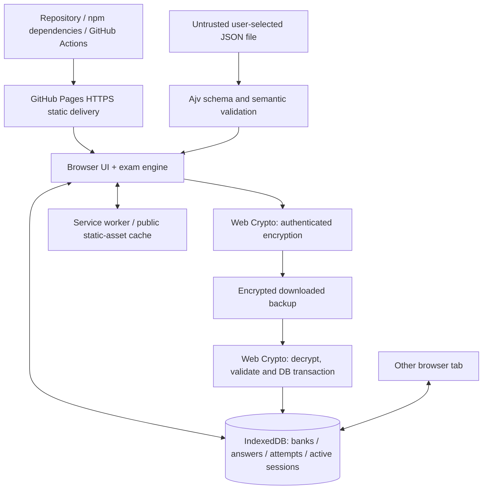

# SEC-001 — Architecture review and conditional acceptance record

**Version:** 1.1 (2026-11-06)  
**Repository baseline:** main, ExamPrep Engine v0.2.0  
**Tracking:** [SEC-001 #21](https://github.com/Yenuka2012/examprep-engine/issues/21) and [SEC-002 #22](https://github.com/Yenuka2012/examprep-engine/issues/22)  
**Status:** REVIEW READY — NOT OWNER APPROVED

## 1. Intended system
A personal, offline-first, browser-only examination preparation PWA served as a public static application via GitHub Pages. Runtime certification question banks, answer keys, ongoing sessions, and attempt history are stored in the local user's browser profile, not in the public repository or application bundle. No user accounts, backend, runtime API, external LLM, third-party analytics, paid cloud services, or cross-device sync are authorized by this design.

## 2. Verified code inventory

| Component | Code | Boundary and purpose |
|---|---|---|
| Static application | `index.html`, `vite.config.ts` | HTTPS delivery of public JS, CSS, HTML, icon and PWA resources |
| UI controller | `src/App.tsx` | Bank import, exam navigation, timed submission, analytics, backup UI |
| JSON validator | `src/logic.ts` | Ajv strict 1.0 bank schema; cross-field integrity and exact answer matching |
| Browser persistence | `src/db.ts` | Dexie DB `examprep-v1` v2; banks, attempts, active session |
| Encryption | `src/crypto.ts` | Local Web Crypto AES-256-GCM backup, PBKDF2-HMAC-SHA-256, 600k iterations |
| Restore validation | `src/backup.ts` | Frozen question snapshots and scores checked before DB mutation |
| CI/CD | `.github/workflows/` | Reproducible npm install, audit, typecheck, tests, build, CodeQL, Pages publish |

## 3. Data flow and trust boundaries

**TB-01:** Build/supply chain to public origin; malicious scripts at the application origin can read all unencrypted browser data.

**TB-02:** User-selected JSON/backup bytes to browser runtime; validate file size, structure, semantic integrity, computational complexity and limits.

**TB-03:** Browser runtime to IndexedDB; local stored data is not encrypted and browser-profile access is the trust boundary.

**TB-04:** Browser app to backup file; random salts/nonces, authenticated ciphertext, passphrase management, no partial restore.

**TB-05:** Application to service-worker/cache; public static assets only; do not put imported content in Cache Storage.

**TB-06:** Concurrent same-origin browser tabs to shared IndexedDB; no single-writer lock currently enforced.

**TB-07:** GitHub Actions / artifacts to deployed origin; CI permissions, dependency integrity, release review and trusted deployment.

## 4. Accepted *design targets* (not yet owner-approved)

| ADR | Decision | Residual risk / follow-up |
|---|---|---|
| ADR-001 | Retain static GitHub Pages / no backend for M0 | No server-side authentication, true remote authorization, or cross-device sync |
| ADR-002 | Keep browser-local Dexie/IndexedDB | Local records and answer keys are plaintext: BACK-004 / BACK-005 |
| ADR-003 | Treat all imports as hostile | Parser DoS and UI XSS require adversarial browser tests: QB-001 |
| ADR-004 | Preserve question snapshots for scoring | Explicit bank revisioning remains QB-003 |
| ADR-005 | Require single-writer exam lease in next sprint | EX-003 blocks trustworthy cross-tab exam integrity |
| ADR-006 | Encrypted backup export with local Web Crypto | Weak passphrases and recovery failures still possible: BACK-001/002/003 |
| ADR-007 | Precache only public app shell | Cross-version SW/DB safety requires PWA-001/PWA-003 |
| ADR-008 | PR-based secure SDLC | Branch protections, verified action SHA pinning and rollback: OPS-002/003/006 |
| ADR-009 | Defer encrypted-at-rest vault until key lifecycle design | Do not claim privacy from extensions/browser-profile compromise |
| ADR-010 | Future authentication/AI requires separate backend security design | No frontend-only access controls or client-embedded API tokens |

## 5. Important verified implementation gaps
1. `src/App.tsx` manages exam and persistence lifecycle in one component. Separate the exam state machine after M0 test coverage.
2. Session ownership is not locked across tabs. Race conditions may overwrite progress or complete an exam more than once.
3. Autosave uses queued async writes and session deletion; recovery on storage-denied, crash, or multi-tab behavior lacks browser-level evidence.
4. Backups include banks and completed attempts but exclude an unfinished active session. State this clearly, and define recovery expectations in BACK-003.
5. GitHub Pages lacks arbitrary HTTP security header configuration. An HTML CSP meta element cannot enforce all response-header policies, including `frame-ancestors`.
6. The PWA and site behavior have not been independently verified with Firefox, Chromium, and WebKit mobile browser flows.

## 6. Owner decisions to record before closure
- [ ] May ordinary personal question banks remain plaintext in browser IndexedDB, or is encrypted-at-rest a P0 requirement?
- [ ] Is one active exam writer with a read-only secondary tab acceptable?
- [ ] Is excluding unfinished sessions from backup v1 acceptable?
- [ ] Are GitHub Pages' HTTP-header limits acceptable for the personal-only release?
- [ ] Is publication limited to synthetic/openly licensed sample questions?
- [ ] Has the GitHub Project #3 auto-add intake and 50-record backlog been verified?

### Acceptance evidence required
- Owner acceptance of data classification and above decisions.
- SEC-002 risk priorities linked and documented.
- All remaining high-risk controls tracked as Issues.
- CI and browser evidence for any changed implementation.
- Final SEC-001 owner approval/sign-off note before closing #21.

**No changes to current runtime architecture are authorized by this review document alone.**
